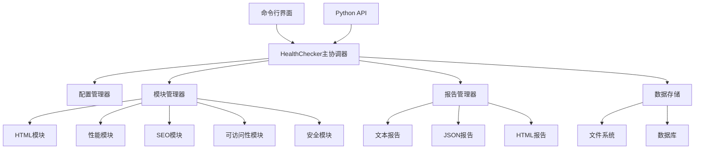
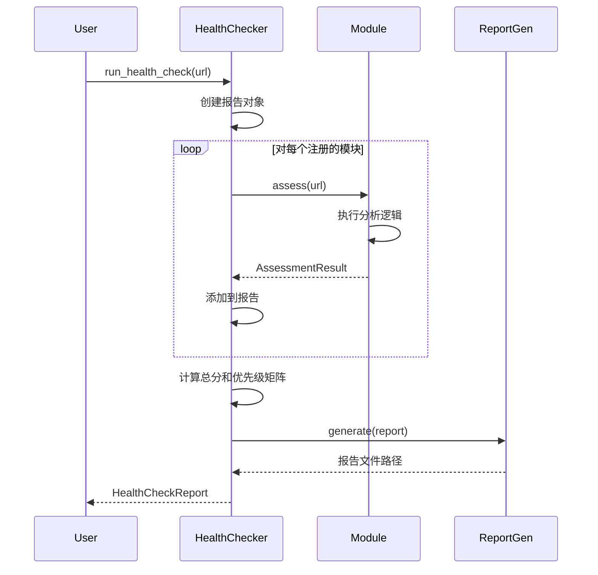
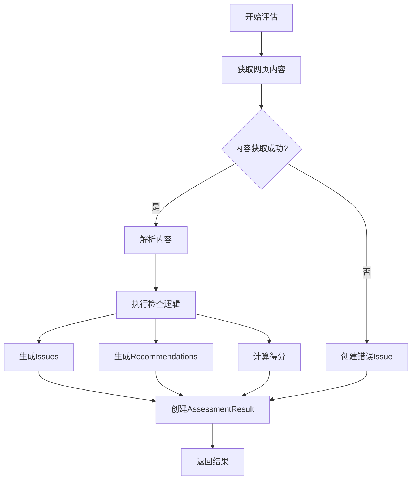

# 架构设计文档

## 🏗️ 系统架构概览



## 🔧 核心组件设计

### 1. HealthChecker (主协调器)

**职责**:
- 协调所有评估模块的执行
- 管理并发和超时
- 聚合评估结果
- 触发报告生成

**关键方法**:
```python
class HealthChecker:
    def __init__(self, config: HealthCheckConfig)
    def register_module(self, module: AssessmentModule)
    def register_report_generator(self, generator: ReportGenerator)
    async def run_health_check(self, target_url: str) -> HealthCheckReport
    async def generate_reports(self, report: HealthCheckReport) -> List[str]
```

**设计模式**: 
- **协调器模式**: 统一管理各个模块
- **观察者模式**: 模块注册和事件通知
- **策略模式**: 不同的评估策略

### 2. AssessmentModule (评估模块基类)

**职责**:
- 定义评估模块的标准接口
- 提供通用的辅助方法
- 处理模块级别的配置和错误

**抽象接口**:
```python
class AssessmentModule(ABC):
    @abstractmethod
    async def assess(self, target_url: str) -> AssessmentResult
    
    @abstractmethod
    def get_module_info(self) -> Dict[str, Any]
    
    # 辅助方法
    def create_issue(self, ...) -> Issue
    def create_recommendation(self, ...) -> Recommendation
    def is_enabled(self) -> bool
    def get_timeout(self) -> int
```

**设计模式**:
- **模板方法模式**: 定义评估流程框架
- **工厂方法模式**: 创建Issue和Recommendation对象

### 3. 配置系统

**层次结构**:
```
HealthCheckConfig
├── 全局配置 (并发数、超时等)
├── ModuleConfig (基础模块配置)
│   ├── PerformanceConfig
│   ├── SecurityConfig  
│   ├── AccessibilityConfig
│   └── SEOConfig
└── ReportConfig (报告配置)
```

**配置来源优先级**:
1. 代码中直接设置
2. 配置文件 (YAML/JSON)
3. 环境变量
4. 默认值

### 4. 数据模型

**核心实体关系**:
```mermaid
classDiagram
    class HealthCheckReport {
        +assessment_id: str
        +timestamp: datetime
        +website_url: str
        +overall_score: float
        +modules: Dict[str, AssessmentResult]
        +priority_matrix: List[Recommendation]
    }
    
    class AssessmentResult {
        +module_name: str
        +score: float
        +issues: List[Issue]
        +recommendations: List[Recommendation]
        +metrics: Dict[str, Any]
        +execution_time: float
    }
    
    class Issue {
        +id: str
        +type: str
        +severity: Severity
        +message: str
        +location: Dict[str, Any]
        +fix_suggestion: str
    }
    
    class Recommendation {
        +id: str
        +title: str
        +description: str
        +priority: Priority
        +effort: Effort
        +impact: Impact
        +estimated_hours: float
    }
    
    HealthCheckReport ||--o{ AssessmentResult
    AssessmentResult ||--o{ Issue
    AssessmentResult ||--o{ Recommendation
```

## 🔄 执行流程

### 1. 健康检查执行流程



### 2. 模块评估流程



### 3. 并发控制

**异步并发策略**:
```python
# 使用信号量控制并发数
semaphore = asyncio.Semaphore(max_concurrent_assessments)

async def _run_single_assessment(self, semaphore, module, url, report):
    async with semaphore:
        # 执行评估逻辑
        result = await asyncio.wait_for(
            module.assess(url),
            timeout=module.get_timeout()
        )
```

**优势**:
- 避免过多并发请求导致目标网站压力
- 防止单个模块阻塞整个检查流程
- 支持超时控制和错误隔离

## 📊 扩展性设计

### 1. 模块扩展

**新模块添加步骤**:
1. 继承`AssessmentModule`基类
2. 实现`assess()`和`get_module_info()`方法
3. 在配置中添加对应的配置类
4. 注册到`HealthChecker`

**示例**:
```python
class CustomModule(AssessmentModule):
    async def assess(self, target_url: str) -> AssessmentResult:
        result = AssessmentResult(self.name, 0.0)
        
        # 自定义检查逻辑
        if some_condition:
            issue = self.create_issue(
                "custom_issue",
                Severity.WARNING,
                "发现自定义问题"
            )
            result.add_issue(issue)
        
        return result
```

### 2. 报告生成器扩展

**新报告格式添加**:
```python
class PDFReportGenerator(ReportGenerator):
    def generate(self, report: HealthCheckReport) -> str:
        # PDF生成逻辑
        return pdf_file_path
    
    def get_supported_formats(self) -> List[str]:
        return ["pdf"]
```

### 3. 配置扩展

**新配置类型**:
```python
@dataclass
class CustomModuleConfig(ModuleConfig):
    custom_parameter: str = "default_value"
    custom_threshold: float = 0.8
```

## 🔒 安全性考虑

### 1. 输入验证
- URL格式验证
- 配置参数验证
- 文件路径安全检查

### 2. 网络安全
- 请求超时控制
- 用户代理设置
- SSL证书验证

### 3. 资源限制
- 内存使用限制
- 并发数量控制
- 文件大小限制

## ⚡ 性能优化

### 1. 异步I/O
- 使用`aiohttp`进行异步HTTP请求
- 并发执行多个评估模块
- 非阻塞的文件操作

### 2. 缓存策略
```python
# 计划中的缓存机制
class CacheManager:
    def get_cached_result(self, url: str, module: str) -> Optional[AssessmentResult]
    def cache_result(self, url: str, module: str, result: AssessmentResult)
    def is_cache_valid(self, timestamp: datetime) -> bool
```

### 3. 资源优化
- 连接池复用
- 内存使用监控
- 垃圾回收优化

## 🧪 测试架构

### 1. 测试层次
```
单元测试 (Unit Tests)
├── 数据模型测试
├── 配置系统测试
├── 基础类测试
└── 工具函数测试

集成测试 (Integration Tests)
├── 模块集成测试
├── 报告生成测试
└── 端到端流程测试

性能测试 (Performance Tests)
├── 并发性能测试
├── 内存使用测试
└── 响应时间测试
```

### 2. Mock策略
```python
# 网络请求Mock
@pytest.fixture
def mock_http_response():
    with patch('requests.get') as mock_get:
        mock_get.return_value.content = "<html>...</html>"
        yield mock_get

# 模块Mock
class MockAssessmentModule(AssessmentModule):
    async def assess(self, target_url: str) -> AssessmentResult:
        # 返回预定义的测试结果
        pass
```

## 📈 监控和日志

### 1. 日志系统
```python
# 分层日志记录
logger = logging.getLogger('health_check')
logger.info("开始健康检查")
logger.debug("模块执行详情")
logger.error("错误信息")
```

### 2. 性能监控
- 执行时间统计
- 内存使用监控
- 错误率统计
- 成功率追踪

### 3. 指标收集
```python
# 计划中的指标系统
class MetricsCollector:
    def record_execution_time(self, module: str, duration: float)
    def record_error(self, module: str, error_type: str)
    def record_success(self, module: str, score: float)
```

## 🔮 未来架构演进

### 1. 微服务架构
- 将各个模块拆分为独立服务
- 使用消息队列进行通信
- 支持水平扩展

### 2. 插件系统
- 动态加载评估模块
- 插件市场和版本管理
- 第三方插件支持

### 3. 云原生支持
- Kubernetes部署
- 容器化模块
- 自动扩缩容

---

**文档版本**: v1.0  
**最后更新**: 2025-12-31  
**维护者**: Development Team